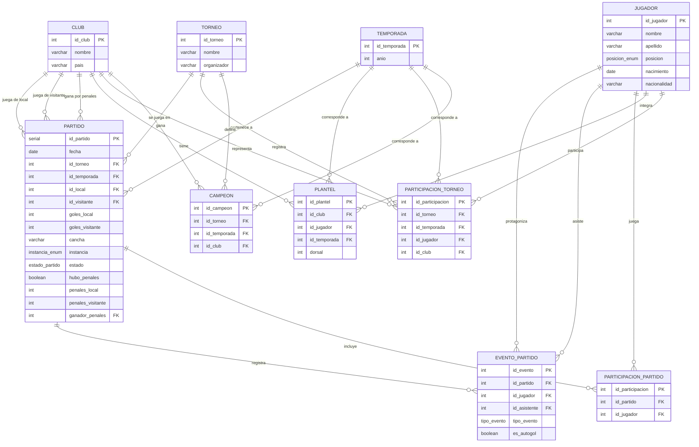

# ⚽ Inter Nados FC — Sistema de Estadísticas

Base de datos relacional en **PostgreSQL** para registrar y analizar la historia completa del club: jugadores, partidos, torneos, temporadas, rivales y eventos de cada partido (goles, asistencias, tarjetas, etc.).

El objetivo es transformar los datos de cada partido en estadísticas útiles y, en próximas etapas, exponerlos mediante una API REST y un sitio web.

---

## 📊 El proyecto en números

| Dato | Cantidad |
|---|---|
| Partidos registrados | 125 |
| Jugadores | 63 |
| Temporadas | 6 |
| Torneos | 16 |
| Rivales | 59 |
| Eventos registrados (goles, amarillas y rojas) | 531 |
| Views de estadísticas | 20 |

---

## 🛠️ Tecnologías

- **PostgreSQL** — motor de base de datos
- **SQL** — modelado, consultas y views
- **pgAdmin 4** — administración de la base y diagrama entidad-relación
- **Git y GitHub** — control de versiones

---

## 🗂️ Modelo de datos

El modelo tiene **11 tablas** y **4 tipos ENUM** (`posicion_enum`, `instancia_enum`, `estado_partido`, `tipo_evento`).



**Decisiones de diseño:**
- **Local y visitante como claves foráneas a `club`:** el club propio y los rivales viven en la misma tabla, lo que permite registrar cualquier partido y calcular el historial contra cada rival.
- **Tipos ENUM** para posición, instancia, estado del partido y tipo de evento: la base solo acepta valores válidos y se evitan errores de carga.
- **Gol y asistencia en un mismo evento:** `evento_partido` guarda al autor y, opcionalmente, al asistente (`id_asistente`), y marca los autogoles con `es_autogol`.
- **Plantel por temporada:** un jugador puede cambiar de club o de dorsal entre temporadas sin perder su historial.
- **Penales registrados aparte:** `hubo_penales`, el resultado de la tanda y `ganador_penales` permiten definir partidos empatados sin alterar el marcador.
- **Estadísticas calculadas con views:** no se guardan totales, se calculan siempre a partir de los datos y quedan actualizadas.

---

## 🔎 Views destacadas

La base cuenta con **20 views** que calculan las estadísticas directamente a partir de los datos.

### Club

| View | Qué calcula |
|---|---|
| `estadisticas_club` | Estadísticas históricas: partidos, victorias, empates, derrotas, goles a favor y en contra |
| `estadisticas_club_temporada` | Las mismas estadísticas, separadas por temporada |
| `historial_partidos` | Todos los partidos con fecha, rival, resultado, marcador, instancia y penales |
| `historial_rivales` | Historial contra cada rival: PJ, PG, PE, PP y diferencia de goles |
| `partidos_penales` | Partidos definidos por penales, con el marcador de la tanda y el ganador |
| `rachas_club` | Rachas históricas de victorias, derrotas, invicto y partidos seguidos marcando |
| `palmares_club` | Títulos obtenidos, con torneo y temporada |

### Jugadores

| View | Qué calcula |
|---|---|
| `estadisticas_jugadores` | Estadísticas históricas: partidos, victorias, goles, asistencias, tarjetas, goles KO y vallas invictas |
| `estadisticas_jugadores_temporada` | Las mismas estadísticas, separadas por temporada |
| `efectividad_jugadores` | Promedios: goles y asistencias por partido, participaciones de gol y porcentaje de victorias |
| `records_jugadores` | Récords históricos: más partidos, goles, asistencias, victorias y tarjetas |
| `debut_jugadores` | Primer partido de cada jugador, con rival, resultado y su rendimiento en el debut |
| `goles_jugador_rival` | A qué rivales les convirtió cada jugador, cuántos goles y en cuántos partidos |
| `multiples_goles_partido` | Partidos con 2 o más goles de un jugador: dobletes, hat-tricks, pókeres, etc. |
| `palmares_jugadores` | Títulos de cada jugador según su participación en los torneos ganados |
| `rendimiento_club_con_jugador` | Resultados y porcentajes del equipo en los partidos que jugó cada jugador |

### Relaciones entre jugadores

| View | Qué calcula |
|---|---|
| `duplas_goleador_asistente` | Goles de un jugador asistidos por otro, distinguiendo quién convirtió y quién asistió |
| `duplas_goleadoras` | Parejas que más goles generaron entre ambos, en las dos direcciones |
| `jugadores_mas_partidos_juntos` | Cantidad de partidos que jugó junta cada pareja de jugadores |

### Partidos

| View | Qué calcula |
|---|---|
| `detalle_partidos` | Detalle de cada partido: participantes, goleadores, asistentes y tarjetas |

---

## 📈 Ejemplos de resultados

### Máximos goleadores históricos

```sql
SELECT jugador, partidos, goles, asistencias, goles_ko
FROM estadisticas_jugadores
ORDER BY goles DESC
LIMIT 5;
```

| jugador | partidos | goles | asistencias | goles_ko |
|---|---|---|---|---|
| Juan Medina | 69 | 51 | 17 | 6 |
| Lucio Vega | 66 | 45 | 15 | 7 |
| Diego Acosta | 56 | 32 | 11 | 4 |
| Santiago Floretta | 93 | 28 | 28 | 5 |
| Ivo Valetti | 17 | 14 | 12 | 1 |

### Rivales más enfrentados

```sql
SELECT rival, pj, pg, pe, pp, gf, gc, dif
FROM historial_rivales
ORDER BY pj DESC
LIMIT 5;
```

| rival | pj | pg | pe | pp | gf | gc | dif |
|---|---|---|---|---|---|---|---|
| Real Rejunte | 6 | 3 | 0 | 3 | 12 | 18 | -6 |
| Barril | 6 | 0 | 0 | 6 | 11 | 25 | -14 |
| TFC | 5 | 3 | 2 | 0 | 13 | 8 | 5 |
| Birra Fratelli | 5 | 3 | 1 | 1 | 16 | 15 | 1 |
| Citizens | 5 | 2 | 1 | 2 | 11 | 12 | -1 |

---

## 📁 Estructura del repositorio

```
├── schema.sql      # Tablas, tipos ENUM, claves, restricciones y views
├── data/
│   └── datos.sql   # Datos de los 125 partidos
├── views/          # Cada view de estadísticas en su propio archivo
└── README.md
```

---

## ▶️ Cómo ejecutarlo

```bash
# 1. Crear la base de datos
createdb inter_nados

# 2. Crear las tablas, tipos y views
psql -d inter_nados -f schema.sql

# 3. Cargar los datos
psql -d inter_nados -f data/datos.sql
```

---

## 🚀 Próximos pasos

- [x] Modelo de datos y carga de 125 partidos
- [x] 20 views de estadísticas
- [ ] Nuevas views (8 en desarrollo)
- [ ] API REST con Java + Spring Boot
- [ ] Dashboard en Power BI
- [ ] Sitio web público del club

---

## 👤 Autor

**Ignacio Martínez Tarigo** — Estudiante de Licenciatura en Informática (UDE)

[LinkedIn](https://linkedin.com/in/ignacio-martinez-tarigo) · ignamartar1301@gmail.com
